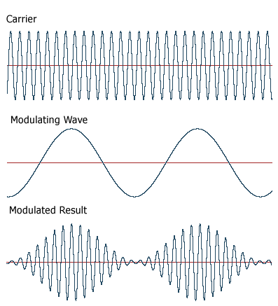

# NJD Siren

**njd-siren** is a siren built with [VueJS](https://vuejs.org/) and based on the [WebAudioAPI](https://www.w3.org/TR/webaudio/), it is famous in reggae and sound-system culture.

[Demonstration](https://siren.dubsounds.fr)

## Working

The principle is a **main oscillator** that produces a wave. Beside, another oscillator that we call the **low frequency oscillator** (LFO) produces another wave. The oscillations of the LFO are modifying the frequency of the main oscillator, as a result, the frequency (pitch) of the main oscillator keeps changing, this is called **modulation**. The result is a siren that sounds like the cops, or the ambulance.

## Usage

The siren is hosted [here](https://siren.dubsounds.fr).

It is laid out like a sound-system control tower, a wooden rack of units under the turntable:

- **Siren**: Tone, Speed, Depth, LFO wave (sine, triangle, square, saw, ramp down, random steps), Carrier, Sweep and Glide (pitch swoop on each press), Release, Volume.
- **Filter**: Drive, low-pass Cutoff and Resonance, LFO to cutoff.
- **Echo**: Time, Repeat, Tone, Wow, Mix, mono or ping-pong, Tap tempo and Throw.
- **Spring**: Dwell, Tone, Mix, and the springs can be kicked.

Knobs turn by dragging up and down or with the mouse wheel (Shift for fine moves, double-click to reset).

| Key | Action |
| --- | --- |
| Space (hold) | Siren |
| 1 – 5 | Presets |
| R | Random sound |
| E (hold) | Throw into the echo |
| T | Tap the echo tempo |
| ? | Shortcuts card |

Everything runs on the Web Audio API, there is no audio library.
